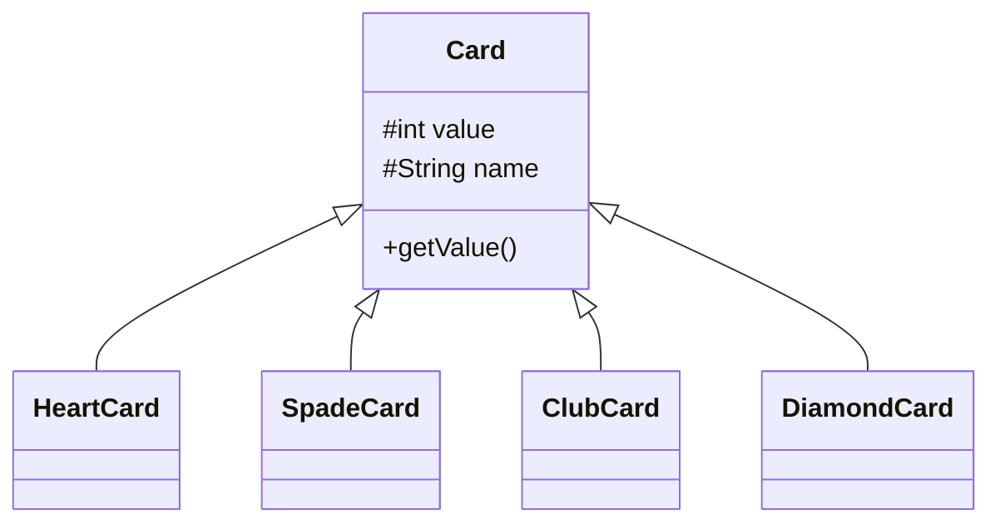

<p align="center">
  
</p>

<p align="center">
   
</p>


## 📌 Table of Contents
- [📖 Executive Summary](#-executive-summary)
- [✨ Key Features & Capabilities](#-key-features--capabilities)
- [🏗️ System Architecture & Workflow](#️-system-architecture--workflow)
- [🛠️ Tech Stack Breakdown](#️-tech-stack-breakdown)
- [⚙️ Reproducible Quickstart & Setup](#️-reproducible-quickstart--setup)
- [📂 Project Directory Layout](#-project-directory-layout)
- [👩‍💻 Author & Contributions](#-author--contributions)

---

## 📖 Executive Summary
### Problem Statement
Implementing traditional casino card games requires modeling card hierarchies and suit-specific behavior through clean object-oriented inheritance.

### Motivation & Solution Overview
A Java simulation of Blackjack implementing an inheritance hierarchy with specialized card classes (`HeartCard`, `SpadeCard`, `ClubCard`, `DiamondCard`) extending a base `Card` class.

---

## ✨ Key Features & Capabilities
- **Class Inheritance:** Subclassed suits extending base `Card` entities.
- **Game State Logic:** Hand evaluation, bust detection, and dealer turn resolution.
- **Clean Java Console Interface:** Interactive game loop.

---

## 🏗️ System Architecture & Workflow


---

## 🛠️ Tech Stack Breakdown
| Category | Technologies |
|---|---|
| **Language** | Java |
| **Concepts** | Inheritance, Polymorphism, Encapsulation, Console Game Loop |

---

## ⚙️ Reproducible Quickstart & Setup
```bash
git clone https://github.com/Bhumikaravi/Bhumika_BlackJack.git
cd Bhumika_BlackJack
javac *.java
java Main
```

---

## 📂 Project Directory Layout
```text
Bhumika_BlackJack/
├── Card.java
├── ClubCard.java
├── DiamondCard.java
├── HeartCard.java
├── SpadeCard.java
├── Main.java
└── README.md
```

---

## 👩‍💻 Author & Contributions
Developed by **Bhumika Ravi** ([@Bhumikaravi](https://github.com/Bhumikaravi)), Bachelor of Computer Applications (BCA) at **Alliance University, Bengaluru**.

- 💻 **GitHub Profile:** [github.com/Bhumikaravi](https://github.com/Bhumikaravi)
- 🔗 **LinkedIn:** [linkedin.com/in/bhumika-ravi-b5a01b326](https://www.linkedin.com/in/bhumika-ravi-b5a01b326/)
- 📬 **Email Contact:** [bhumikaravi2006@gmail.com](mailto:bhumikaravi2006@gmail.com)

---

<p align="center">
  
</p>
